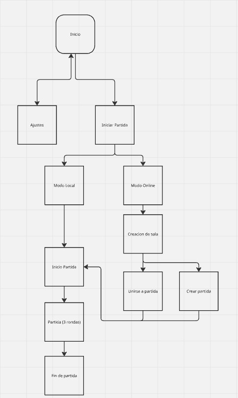

# GDD - TIMBERWARS

## 1. Ficha del Proyecto y Créditos 
**Nombre del juego:** Timber Wars  
**Grupo:** H

**Autores:**  
* Raúl Núñez González
* Hugo Martínez Albendea
* Leo Lin
* Álvaro Ruiz Martínez

**Asignatura:** Juegos en red (3º Grado en diseño y desarrollo de videojuegos)  
**Repositorio:** [Enlace de GitHub](https://github.com/alvarOmega07/TimberWars)

---

## 2. Índice
*(Tabla de contenidos organizada con hipervínculos internos en Markdown)*
* [1. Ficha del Proyecto y Créditos](#1-ficha-del-proyecto-y-créditos)
* [3. Especificaciones](#3-especificaciones)
* [4. Jugabilidad y Mecánicas (Gameplay)](#4-jugabilidad-y-mecánicas-gameplay)
  * [4.2. Mecánicas](#42-mecánicas)
  * [4.3. Controles J1 / J2 (Local)](#43-controles-j1--j2-local)
  * [4.4. Físicas](#44-físicas)
  * [4.5. Flujo de la partida](#45-flujo-de-la-partida)
  * [4.6. Diagrama de flujo del juego](#46-diagrama-de-flujo-del-juego)
* [5. Imagen y Diseño Visual](#5-imagen-y-diseño-visual)
  * [5.1. Logotipo del juego](#51-logotipo-del-juego)
  * [5.2. Estilo visual](#52-estilo-visual)
  * [5.3. Paleta de colores y atmósfera](#53-paleta-de-colores-y-atmósfera)
  * [5.4. Cámara y perspectiva (Uso de cámara en 2D)](#54-cámara-y-perspectiva-uso-de-cámara-en-2d)
  * [5.5. Bocetos](#55-bocetos)
  * [5.6. Inspiración](#56-inspiración)
* [6. Narrativa y Personajes y Objetos](#6-narrativa-y-personajes-y-objetos)
  * [6.1. Historia y trasfondo del juego](#61-historia-y-trasfondo-del-juego)
  * [6.2. Desarrollo e historia de los personajes](#62-desarrollo-e-historia-de-los-personajes)
  * [6.3. Armas](#63-armas)
* [7. Diseño Sonoro](#7-diseño-sonoro)
  * [7.1. Banda sonora y música](#71-banda-sonora-y-música)
  * [7.2. Efectos de sonido](#72-efectos-de-sonido)
* [8. Estrategia de Comunicación y Marketing](#8-estrategia-de-comunicación-y-marketing)
  * [8.1. Plan de difusión y comunicación del proyecto](#81-plan-de-difusión-y-comunicación-del-proyecto)
* [9. Referencias Bibliográficas](#9-referencias-bibliográficas)
---

## 3. Especificaciones
* **Género del juego:** Arcade y Multijugador 2D 
* **Público objetivo:** Jugadores casuales mayores de 12 años.
* **Plataforma de destino:** Navegador Web
* **Visión General:** Juego multijugador donde los jugadores son castores que luchan por su supervivencia, peleando a muerte con los demás jugadores de la partida.

---
## 4. Jugabilidad y Mecánicas (Gameplay)

### 4.2. Mecánicas:
* **Movimiento e Inercia:** El control del personaje se basa en una movilidad ágil en 2D. El castor cuenta con un desplazamiento horizontal, capacidad de salto y un ligero peso que permite ajustar trayectorias en el aire, para que sea capaz de esquivar proyectiles y moverse rápido por el escenario.
* **Sistema de Combate (One-Hit Kill):** El sistema de combate se basa en una única oportunidad de vida, es decir (muerte instantánea). Cualquier impacto directo de proyectil, explosión o peligro ambiental elimina al jugador al instante. Esta letalidad genera rondas de corta duración, con un ritmo de juego frenético y una alta rejugabilidad.
* **Gestión de inventario:**
    * **Capacidad:** Cada castor puede transportar un máximo de un arma.
    * **Acciones de Manipulación:** El jugador puede equipar, disparar o arrojar el arma en cualquier momento. Arrojar un arma sin munición o un objeto pesado puede utilizarse tácticamente como proyectil secundario para empujar a un rival.
    * **Arsenal Temático y Convencional:** Se incluye una selección diversa de armas de fuego tradicionales (pistolas, escopetas, fusiles).
* **Interacción social:** Hay un botón dedicado para emitir un sonido característico del castor que los jugadores pueden usar a modo de mofa o de interacción social entre partidas.

### 4.3. Controles J1 / J2 (Local)
* **Movimiento:** `WASD` / `Flechas direccionales`
* **Recoger/Soltar:** `E` / `K`
* **Disparar/Usar:** `Barra Espaciadora` / `L`
* **Emote:** `C` / `M`

### 4.4. Físicas
* **Disparos:** De las físicas más relevantes, se incluye el sistema de disparos en el que el jugador al portar un arma y apretar el botón de disparo, disparará según las características del arma.
* **Balística:** La variedad de armas incluirá su propio modo de disparo desde disparo simple, semiautomático, hasta proyectiles con trayectoria física y caída por gravedad como las granadas.
* **Retroceso:** Al disparar un arma generará un retroceso en el que el jugador se eche para atrás según la fuerza del retroceso al disparar el arma.
* **Salto y Caída libre:** El jugador podrá saltar los obstáculos o hacia las diferentes plataformas del escenario el cual contará con zonas sin suelo por las que el jugador podría morirse de caída.
* **Muerte:** Al ser alcanzado por un disparo o impacto, el personaje pierde el control de forma inmediata y activa un sistema de físicas de cuerpo blando, colapsando y saliendo despedido según la dirección del impacto recibido.
* **Objetos interactuables:** Habrá objetos repartidos por el escenario con los que el jugador podrá interactuar, es decir un barril que al dispararlo explota, una caja que se rompe..

### 4.5. Flujo de la partida
* **Estructura de juego:** Accesible tanto en modo local (pantalla compartida) como en línea.

* El juego no tendrá niveles, sino que contará con un modo de juego que será el de jugar en local o online; cualquiera de los dos iniciará la partida en la que habrá 5 rondas y el que gane más rondas, ganará la partida. Además, cuenta con varios mapas; se incluirán como mínimo 3 diferentes mapas pudiendo incluir más a posteriori.

### 4.6. Diagrama de flujo del juego

*(Figura 1. Creada con Miro)*
* **Inicio:** Menú principal donde se le presenta al jugador el juego.
* **Ajustes:** Configuración de audio y video.
* **Inicio de Partida:** Creación de una sala en local o online y la selección de personajes.
* **Modo Online:** Elegir cómo quiere jugar el usuario en línea, si quiere ser el que crea el servidor o el que se une por medio de un código o lo que se implemente para su acceso.
* **Modo Local:** Partida en la que se juega en el mismo dispositivo utilizando los controles del modo local, donde unos son para el jugador 1 y otro el jugador 2.
* **Partida:** Inicio de partida que durará 3 rondas. Cada ronda los jugadores aparecerán en el mapa y tendrán que coger las armas que aparecerán esparcidas por el escenario para matar a sus contrincantes; con una bala mueren. Al morir no reaparecen, hasta la próxima ronda en un mapa diferente al actual.
* **Fin de Partida:** Finaliza la partida declarando al ganador de la partida o a los ganadores en caso de un empate.

---

## 5. Imagen y Diseño Visual

### 5.1. Logotipo del juego
*(Espacio reservado para el logotipo)*

### 5.2. Estilo visual 
Se utilizará el arte del pixel-art 2D para todos los escenarios, objetos y personajes.
Durante la partida los personajes tendrán un dibujo más sencillo, mientras que en la selección de personajes serán más detallados, con un encuadre cerrado que muestre la cabeza.

### 5.3. Paleta de colores y atmósfera
Colores cálidos: como los castores son los personajes principales, usaremos una paleta de colores que guarde relación con el hábitat de estos animales, que suelen ser bosques y cuerpos de agua.

### 5.4. Cámara y perspectiva (Uso de cámara en 2D)
La perspectiva será lateral, y la cámara será multiobjetivo con zoom dinámico: al ser multijugador se desea que la cámara capte a todos los jugadores y se acerque o aleje dependiendo de cómo de cerca estén los jugadores o cuántos queden vivos.
Se usará una baja resolución y posteriormente se escalará, con un escalado de enteros para agrandar los píxeles.

### 5.5. Bocetos
*Pistola*

### 5.6. Inspiración
La principal inspiración de este juego es Duck Game, pero también hay cierta inspiración en el juego Smash Bros.
Además, también se hará referencia a los hábitos de los castores en su hábitat en los escenarios, armas y personajes.

---

## 6. Narrativa y Personajes y Objetos

### 6.1. Historia y trasfondo del juego 
En un mundo donde los seres humanos ya no tienen cabida en el planeta Tierra, debido a una gran catástrofe provocada por ellos mismos. En el planeta actual existe una gran raza de castores, que son los actuales líderes del planeta, pero en base a los pocos recursos que existen, la vida se ha convertido en una lucha constante para la supervivencia de cada uno.

Haciendo así que los castores evolucionen de una manera exponencial, creando armas con lo poquito que dejaron los seres humanos. La vida ahora es una guerra contra iguales donde solo sobreviven los más fuertes y despiadados. 

### 6.2. Desarrollo e historia de los personajes
Los personajes en este juego serán castores con diferentes rasgos que les diferencien:
* **Pol “el novato”:** El castor más joven. Aunque sea el que menos experiencia tenga, tiene la suficiente inteligencia como para poder suplir esta falta. No por ser el más joven dudará en matar para sobrevivir, ya que él solo conoce el mundo tal y como es ahora. Es el personaje principal, el avatar que utilizaremos al principio.
* **Chuck “el ingeniero”:** Fue el que en un principio creó todas las armas que existen pero debido a su naturaleza amable decidió compartir sus secretos con quien no debía, siendo ahora desconfiado y despiadado con cualquiera que se cruza.
* **Vilgax “el superviviente”:** Es conocido por ser el más cruel debido a que no conoce lo que es el amor de una familia. Sus primeros recuerdos son sus hermanos, los cuales fallecieron para protegerlo; desde ese entonces, solo sobrevive para darle una razón de peso a la muerte de sus hermanos. 
* **Clas “el veterano”:** Es el más mayor de todos, debido a esto se sabe todos los trucos para poder sobrevivir, además de contar con una sabiduría muy extensa. Sus dientes frontales son más largos debido a que estos nunca dejan de crecer.

### 6.3. Armas
Hay 4 tipos de armas por ahora:
* **La pistola simple:** Una pistola semiautomática que llevan cada personaje por defecto, es muy buena ya que no ocupa casi espacio pero es más lenta a la hora de disparar.
* **La uzi:** Subfusil semiautomático, es muy buena puesto que tiene una cadencia de disparo muy rápida pero con un alcance corto.
* **Fusil:** Se encontrarán dispersos por el mundo, los cuales son muchos más grandes que las pistolas pero al ser un arma automática será notablemente más rápida entre disparos.
* **Granadas:** Igual que los fusiles se encontraban dispersos por la zona y son muy volátiles, deberán de tener cuidado donde las lanzas, porque como te caiga en los pies podrás salir mal parado.

---

## 7. Diseño Sonoro

### 7.1. Banda sonora y música
Para el apartado musical nos vamos a basar en la creación principal de una melodía para identificar nuestro juego. La melodía tiene que ser simple pero pegadiza para que cuando la escuches varias veces se te quede grabada en la cabeza y una vez que la vuelvas a escuchar te venga a la cabeza nuestro juego.

* **Estilo Musical:** Nos basaremos en las melodías con un tema rústico y relajado, utilizando instrumentos acústicos como banjo, guitarra acústica y armónica. Para crear la sensación de estar en el bosque o una presa natural. 
* **Música Menú:** En los menús del juego queremos crear una melodía que transmita un poquito de tensión pero principalmente que retransmita la calma antes de la tormenta para que el jugador se sienta tranquilo pero en alerta. Sobre todo con toda la tensión del juego que va a experimentar en las partidas, cuando salga a los menús le queremos relajar y que descanse un poco para que pueda seguir jugando sin quemarse del juego.
* **Música Batalla:** Para la melodía de las batallas necesitamos una melodía más rápida y agresiva para que el jugador, mientras esté jugando, no pierda el ritmo de las batallas. Queremos que nunca se pierda ese frenetismo de las batallas en ningún momento, por lo que la música no va a parar hasta que se acaben las batallas.
* **Transiciones Fluidas:** Para pasar de una melodía a otra con el uso de desvanecimiento cruzado de 0.5 segundos al pasar del menú de espera a la carga del mapa para evitar cortes bruscos de audio. 

### 7.2. Efectos de sonido
Los efectos de sonido se dividen en tres categorías principales para ofrecer una respuesta sonora clara e inmediata a las acciones de los jugadores:

**Sonidos del Personaje (Castores)**
* **Pasos:** Sonido rápido de pisadas sobre hierba o la madera de la presa.
* **Salto:** Sonido ligero y cómicamente acentuado al despegar del suelo.
* **Impacto:** Chillido agudo de castor al recibir un impacto, seguido del sonido de caída contra el suelo.
* **Muerte:** Grito agonizante y corto de castor al morir.
* **Selección de Skin / Grito de Guerra:** Pequeño gruñido o chillido característico al confirmar personaje.
* **Mueca:** Sonido corto y gracioso del castor al presionar un botón.

**Armas y Combate**
* **Disparo Simple / Pistola:** Impacto seco y contundente.
* **Disparo Semiautomático / Fusil:** Cadencia rápida de disparos con sonido metálico de casquillos al caer.
* **Explosiones:** Sonido grave y retumbante para armas explosivas, acompañado de un ligero silbido previo.
* **Retroceso / Recarga:** Sonido mecánico de amartillado o encasquillado al accionar el mecanismo del arma.
* **Recoger / Soltar Arma:** Sonido de agarrar o soltar madera/metal.

**Interfaz de Usuario (UI) y Entorno**
* **Navegación en Menú:** Sonido de chasquido de madera al pasar sobre botones o hacer clic.
* **Inicio de Ronda:** Sonido de silbato o toque de bocina de madera al arrancar los 3 segundos de cuenta atrás.
* **Fin de Ronda / Victoria:** Melodía corta y alegre de victoria.

---

## 8. Estrategia de Comunicación y Marketing

### 8.1. Plan de difusión y comunicación del proyecto

**Público Objetivo**
* **Perfil:** Jugadores de títulos arcade multijugador party/frenéticos (fans de Duck Game, Brawlhalla, Stick Fight, Ultimate Chicken Horse).
* **Plataforma Principal:** Usuarios de PC y navegadores web que buscan partidas rápidas en local o multijugador online sin necesidad de instalación.

**Canales de Difusión**
1. **GitHub Repository (Devlog Central):** El propio repositorio de GitHub servirá como diario de desarrollo (*devlog*) público. Se mantendrá el `README.md` actualizado en cada fase con imágenes, GIFs animados de gameplay y enlaces directos a las compilaciones jugables.
2. **Plataformas de Distribución Indie:** Itch.io / Newgrounds / Game Jolt: Creación de páginas dedicadas al juego con portada personalizada, capturas de pantalla, descripción del lore y caja de comentarios para recibir *feedback* de la comunidad.
3. **Redes Sociales (X / Twitter & TikTok):**
    * **X (Twitter):** Publicación de fragmentos de código, *concept art* de los castores, bocetos de escenarios y clips cortos usando etiquetas como Dev Log, Indie Game, Gamedev y PixelArt.
    * **TikTok / Instagram Reels:** Clips verticales cortos mostrando situaciones divertidas de jugabilidad (ej. muertes absurdas por retroceso de armas o explosiones en cadena).

**Materiales Promocionales**
* **Logotipo e Identidad Visual:** Diseño del logo oficial de *TimberWars* integrado en el menú principal y en la cabecera de las redes sociales.
* **Trailer Teaser (30 segundos):** Vídeo promocional mostrando el ritmo caótico de las partidas, la variedad de armas y la personalización de las *skins* de castores.
* **Prensa / Factsheet:** Creación de una pequeña ficha técnica del juego (disponible en `README.md`) para facilitar que otros estudiantes o profesores prueben el juego con un solo clic.

---

## 9. Referencias Bibliográficas

**Información de inspiraciones:**
* **Duck Game:** [https://en.wikipedia.org/wiki/Duck_Game](https://en.wikipedia.org/wiki/Duck_Game) 
* **Stickman Fight:** [https://www.youtube.com/watch?v=W2fjeg633HI](https://www.youtube.com/watch?v=W2fjeg633HI) 
* **Smash Bros:** [https://www.smashbros.com/es_ES/stage/](https://www.smashbros.com/es_ES/stage/) 
* **Castores:** [https://www.worldwildlife.org/es/recursos/a-detalle/castores-los-ingenieros-de-los-ecosistemas-por-excelencia/](https://www.worldwildlife.org/es/recursos/a-detalle/castores-los-ingenieros-de-los-ecosistemas-por-excelencia/)

**Diagramas de flujo:** [https://www.ibm.com/es-es/think/topics/workflow-diagram](https://www.ibm.com/es-es/think/topics/workflow-diagram)  
**Música del juego:** [https://eumes.cat/es/musica-para-videojuegos/](https://eumes.cat/es/musica-para-videojuegos/)